# 03 Database design

**For:** developers. The column-by-column reference is the generated
[data dictionary](data-dictionary.md).

PostgreSQL, managed with Prisma. **75 tables** in 14 groups that follow the blueprint
sections. Schema: `prisma/schema.prisma`. Extra rules: `prisma/sql/constraints.sql`.

## Architecture (blueprint §14)

A shared publishing layer plus one specialised table per directory:

```mermaid
erDiagram
  content_items ||--o| business_ideas : "is a"
  content_items ||--o| machines : "is a"
  content_items ||--o| suppliers : "is a"
  content_items ||--o| funding_programmes : "is a"
  content_items ||--o| investment_opportunities : "is a"
  content_items ||--o| guides : "is a"
  content_items ||--o| consultants : "is a"
  content_items ||--o| recipes : "is a"
  content_items ||--o| tools : "is a"
  content_items ||--o| useful_websites : "is a"
  content_items ||--o| news_articles : "is a"
  content_items ||--o{ related_content : "links to"
  content_items ||--o{ verification_checks : "checked by"
  content_items ||--o{ evidence_links : "cites"
  sources ||--o{ evidence_links : "supports"
  content_items ||--o{ media_assets : "has files"
  media_assets ||--o{ file_versions : "versions"

  organizations ||--o| suppliers : "acts as"
  organizations ||--o| funding_providers : "acts as"
  organizations ||--o{ consultants : "employs"
  organizations ||--o{ contacts : "has"
  organizations ||--o{ organization_locations : "branches"

  business_ideas ||--o{ idea_steps : "steps"
  business_ideas ||--o{ budget_scenarios : "low/standard/higher"
  budget_scenarios ||--o{ budget_lines : "lines"

  machines ||--o{ supplier_offers : "sold as"
  suppliers ||--o{ supplier_offers : "offers"
  suppliers ||--o{ supplier_product_listings : "lists"

  funding_providers ||--o{ funding_programmes : "runs"
  funding_programmes ||--o{ application_rounds : "rounds"

  recipes ||--o{ recipe_ingredients : "uses"
  recipes ||--o{ recipe_steps : "method"
  recipes ||--o{ recipe_costings : "dated costings"
  recipe_costings ||--o{ recipe_costing_lines : "priced lines"

  tools ||--o{ tool_versions : "versions"
  tool_versions ||--o{ tool_calculations : "saved results"

  markets ||--o{ price_observations : "observed at"
  products ||--o{ price_observations : "priced"
```

## Table groups

| Group | Tables | Blueprint |
|---|---|---|
| Shared publishing layer | content_items, content_categories, content_locations, content_audiences, content_entitlements, categories, audiences, locations, units, sources, evidence_links, media_assets, file_versions, verification_checks, related_content, content_revisions | §03 |
| People and organizations | users, organizations, organization_members, organization_categories, organization_locations, contacts | §06, §14 |
| Business ideas | business_ideas, idea_steps, budget_scenarios, budget_lines | §04 |
| Machines | machines, supplier_offers | §05 |
| Suppliers | suppliers, supplier_product_listings | §06 |
| Funding | funding_providers, funding_programmes, application_rounds | §07 |
| Guides and opportunities | guides, guide_steps, guide_documents, guide_fees, investment_opportunities | §08 |
| Experts | consultants, consultant_qualifications, consultant_services, consultant_projects, consultant_reviews | §09 |
| Recipes | recipes, recipe_ingredients, recipe_steps, recipe_costings, recipe_costing_lines | §10 |
| Tools | tools, tool_versions, tool_test_cases, tool_calculations | §11 |
| Markets and prices | markets, products, price_observations | §12 |
| Websites and news | useful_websites, news_articles, news_organizations | §13 |
| Membership | membership_plans, subscriptions, payments, saved_items, collections, collection_items, saved_searches, alerts | §14, §17 |
| Review and analytics | submissions, moderation_events, correction_reports, documents, enquiries, contact_reveals, audit_logs, search_events, usage_events | §14, §18 |

## Data rules (blueprint §02 principles)

| Rule | How it is enforced |
|---|---|
| Repeatable information in child tables | Offers, contacts, steps, ingredients, rounds, observations, versions are separate tables |
| Unknown is empty, not zero | Money and quantity columns are nullable. `budget_lines` and `recipe_costing_lines` must have `unknownReason` when the cost is empty (CHECK) |
| Minimum never above maximum | CHECKs on offers, listings, observations, funding amounts, fees, capacities, opportunity capital |
| No negative money | CHECKs on every price, fee, amount and payment |
| Stable currency and unit identifiers | Currency columns must be ISO 4217 codes (CHECK `^[A-Z]{3}$`). `units` is the controlled unit list; conversions only where `toBase` is exact |
| Dates in order | Quote date ≤ valid until; round opens ≤ closes; opportunity opens ≤ deadline |
| Status, checks and freshness are separate | `publicationStatus`, `verification_checks` rows and `lastReviewedAt`/`nextReviewDueAt` are independent |
| Facts vs claims | `evidence_links.claimType`: source fact, editor explanation, estimate, promoter claim |
| History is kept | Price observations are inserted, never updated in place. `content_revisions` stores a snapshot on every admin save. `moderation_events` records each decision |
| One current file version | Partial unique index on `file_versions(mediaAssetId) WHERE isCurrent` |
| One primary location per organization | Partial unique index on `organization_locations` |
| A page never links to itself | CHECK on `related_content` |
| Full-text search | GIN index on title + summary + overview of `content_items` |

All CHECK rules were tested against invalid inserts and correctly rejected them (26 Oct 2026).

## Conventions

- IDs are `cuid` strings. Table names are snake_case (`@@map`); column names are camelCase, so quote them in raw SQL: `"priceMin"`.
- Money is `Decimal(16,2)`; never use floats for money.
- Phone numbers are text.
- Category-specific machine attributes live in `machines.specifications` (JSON). Frequently filtered fields (price, capacity, district, deadline) are real columns.
- Deleting a content item cascades to its specialised record and child rows. Organizations are suspended, not deleted.

## Changing the schema

See [02 Setup and operations → Database changes](../02-setup-and-operations.md#database-changes).
